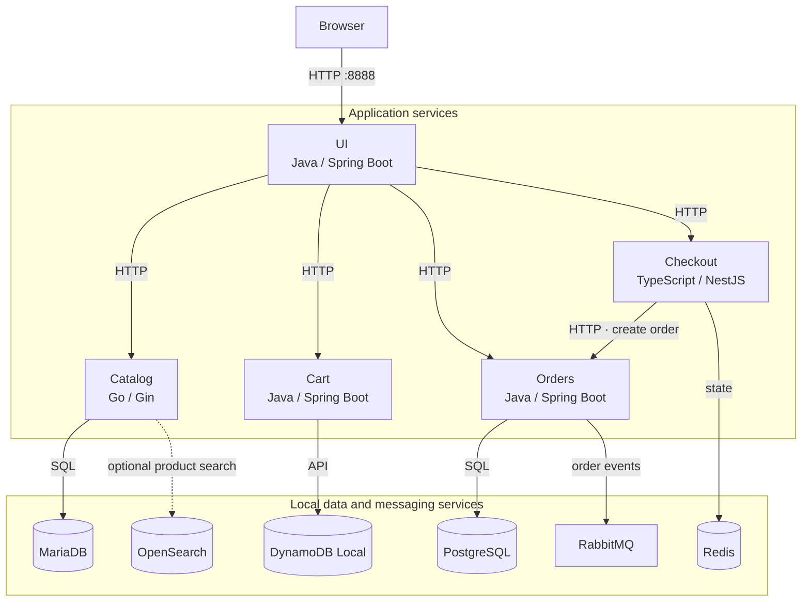
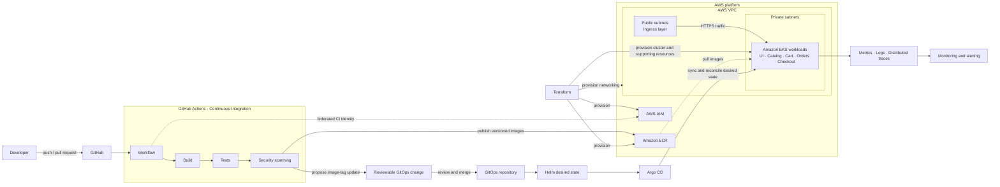

<div align="center">
  <h1>InfraLab v2 — Internal Developer Platform</h1>
  <h3>From Polyglot Microservices to Platform Engineering</h3>

  <p>
    A hands-on project for building a reusable cloud-native platform to deploy,<br />
    operate, observe, and recover polyglot microservices on AWS.
  </p>

  <p>
    
    
    
    
  </p>

  <p><strong>Work in Progress — Local Application Validation</strong></p>
</div>

> [!IMPORTANT]
> The current environment runs the AWS-provided prebuilt service images. InfraLab-owned Dockerfiles, Terraform infrastructure, Amazon EKS, CI/CD pipelines, and GitOps delivery have not been implemented yet.

## Project Overview

InfraLab v2 is a personal DevOps and Platform Engineering project that uses a realistic polyglot application to explore how an Internal Developer Platform can turn fragmented delivery work into a consistent, reusable workflow.

The target outcome is a **Golden Path**: a documented, automated route that lets developers move a service from source control to a secure, observable Kubernetes runtime without having to redesign infrastructure, delivery, and operations for every application. The path should provide useful defaults while preserving explicit review points and application-team ownership.

The reference application is intentionally multilingual—Java, Go, and TypeScript—so the platform must standardize outcomes rather than assume a single build tool or framework.

| Layer | Ownership and scope |
|---|---|
| **Reference application** | Business logic, service APIs, application tests, runtime configuration, and the original microservice source code from AWS. |
| **InfraLab v2 platform** | The evolving container build standards, AWS infrastructure, Kubernetes runtime, CI controls, GitOps delivery, observability, recovery practices, and developer workflow. |

### Current validation boundary

- Repository assessment and platform roadmap are complete.
- The root Docker Compose environment has been started successfully.
- UI, Catalog, Cart, Orders, and Checkout have been observed as `healthy`; the storefront is reachable at `http://localhost:8888`.
- The environment currently uses AWS-published images tagged `1.6.3`.
- Source builds, formal end-to-end tests, data persistence across restarts or container recreation, and cloud deployment are **not yet claimed as validated**.

## Microservices Overview

The service details below are based on the checked-in source, build manifests, runtime configuration, and root Compose file.

| Service | Language | Framework | Primary responsibility | Relevant dependencies in the local environment |
|---|---|---|---|---|
| **UI** | Java 21 | Spring Boot 3.5.16, Thymeleaf, WebFlux | Server-rendered storefront and API aggregation | Catalog, Cart, Orders, and Checkout over HTTP; an optional Recommendations endpoint exists in code but is not deployed by the root Compose file |
| **Catalog** | Go 1.25 | Gin 1.10.1, GORM | Product and tag browsing, product details, and optional keyword search | MariaDB; OpenSearch when search is enabled |
| **Cart** | Java 21 | Spring Boot 3.5.16 | Shopping-cart state by customer | DynamoDB Local |
| **Orders** | Java 21 | Spring Boot 3.5.16, Spring Data JDBC, Flyway | Order creation and listing, plus order-event publication | PostgreSQL and RabbitMQ |
| **Checkout** | TypeScript / Node.js | NestJS 11 | Checkout state and orchestration of order submission | Redis and Orders over HTTP |

## Current Architecture — Docker Compose



Docker Compose creates the shared `retail-sample_default` network and provides embedded DNS resolution for the configured service and host names. Health checks cover the five application services and most data dependencies; conditional startup ordering prevents dependent services from starting before required health checks pass.

OpenSearch is present and receives a named volume in the local stack. It supports Catalog product indexing and keyword search, but both Catalog and UI receive `SEARCH_ENABLED`, which defaults to `false` in `docker-compose.yaml`. The current local `.env` also sets `SEARCH_ENABLED=false`; therefore OpenSearch starts with the stack while search remains disabled unless explicitly enabled.

Host-published ports for UI (`8888`) and OpenSearch (`9200` and `9600`) are bound to `127.0.0.1`. Container-to-container traffic continues to use the internal Compose network and service ports.

## Local Development — Getting Started

### Prerequisites

- Docker Engine
- Docker Compose Plugin (`docker compose`)
- Sufficient CPU, memory, and disk capacity for the five services plus MariaDB, PostgreSQL, DynamoDB Local, Redis, RabbitMQ, and OpenSearch

### 1. Configure the environment

Copy the tracked template and replace its password placeholder with a local value. The resulting `.env` file is ignored by Git.

```bash
cp .env.example .env
```

The template contains:

```dotenv
DB_PASSWORD=replace-with-a-strong-local-password
SEARCH_ENABLED=false
```

- `DB_PASSWORD` supplies the local credentials used by MariaDB, PostgreSQL, RabbitMQ, and their application clients. Reuse is an intentional local-lab simplification; use distinct managed secrets in shared or production environments. Use a local-only value and do not commit it.
- `SEARCH_ENABLED=false` keeps product search disabled. Set it to `true` to enable the UI and Catalog search integration with OpenSearch.

### 2. Start the environment

```bash
docker compose --env-file .env -f docker-compose.yaml up -d
```

### 3. Check service status

```bash
docker compose --env-file .env -f docker-compose.yaml ps
```

Wait for UI, Catalog, Cart, Orders, and Checkout to report `healthy` before using the application.

### 4. Inspect logs

```bash
docker compose --env-file .env -f docker-compose.yaml logs --tail=50
```

### 5. Open the storefront

```text
http://localhost:8888
```

### 6. Stop or remove the environment

Stop services while preserving their containers:

```bash
docker compose --env-file .env -f docker-compose.yaml stop
```

Remove the Compose containers and network:

```bash
docker compose --env-file .env -f docker-compose.yaml down
```

`stop` retains the containers. `down` removes them, so data stored only in container writable layers can be lost. In the current file, OpenSearch has a named volume, while the other local data services do not declare persistent volumes. Do not treat this environment as a persistence guarantee.

## Target Architecture — AWS Platform Engineering

> **Planned architecture — not yet implemented or deployed.**



The intended delivery flow is:

1. A developer submits changes through GitHub.
2. GitHub Actions builds, tests, and scans the application artifacts.
3. Versioned container images are published to Amazon ECR.
4. CI proposes a reviewable update to the desired application version in the GitOps repository.
5. After review and merge, Argo CD reconciles Helm-rendered desired state into Amazon EKS.
6. EKS runs the microservices and pulls the approved images from ECR.
7. Telemetry feeds monitoring and alerting, while GitOps reconciliation and Kubernetes health controls provide the foundation for recovery capabilities.

Terraform is responsible for AWS infrastructure such as networking, IAM, ECR, and EKS. It is **not** responsible for application version promotion; application versions belong to the reviewed GitOps desired state.

## Technology Stack

### Currently used

| Area | Technologies verified in the current repository or local stack |
|---|---|
| Application | Java 21, Spring Boot 3.5.16, Thymeleaf, WebFlux, Go 1.25, Gin, GORM, TypeScript, Node.js, NestJS 11 |
| Local orchestration | Docker Engine, Docker Compose, AWS-published prebuilt images |
| Data and messaging | MariaDB, PostgreSQL, DynamoDB Local, Redis, RabbitMQ, OpenSearch |
| Application operations | Health endpoints, Spring Boot Actuator, Prometheus-compatible metrics, OpenTelemetry instrumentation |

### Planned platform

| Area | Technologies and practices |
|---|---|
| Infrastructure | Terraform, AWS VPC, IAM, Amazon ECR, Amazon EKS |
| Runtime | Kubernetes, Helm |
| Delivery | GitHub Actions, Argo CD, GitOps |
| Operations | Centralized metrics, logs, distributed tracing, monitoring, alerting, scaling, and recovery practices |
| Developer experience | Reusable templates, self-service workflows, and a documented Golden Path |

## Project Roadmap

| Phase | Stage | Technologies / focus | Status |
|:---:|---|---|:---:|
| **01** | **Application Assessment** | Microservices · Architecture Review | ✅ Completed |
| **02** | **Application Validation** | Docker Compose · Health Checks · Integration Tests | 🔄 In progress |
| **03** | **Containerization** | Docker · Multi-stage Builds · Compose | ⏳ Pending |
| **04** | **Kubernetes Local** | Kind · Deployments · Services · Helm | ⏳ Pending |
| **05** | **AWS Infrastructure** | Terraform · VPC · IAM · ECR · EKS | ⏳ Pending |
| **06** | **CI/CD & GitOps** | GitHub Actions · Argo CD · GitOps | ⏳ Pending |
| **07** | **Observability & SRE** | Metrics · Logs · Traces · Scaling · Recovery | ⏳ Pending |
| **08** | **Developer Golden Path** | Reusable Templates · Self-Service Workflow | ⏳ Pending |

[View Project Roadmap](ROADMAP.md)

## Documentation

- [Project Roadmap](ROADMAP.md) — delivery phases and current status
- [Repository Assessment](REPOSITORY_ASSESSMENT.md) — audited repository inventory, risks, and validation boundaries

## Attribution & Licensing

The reference application is the open-source [AWS Retail Store Sample App](https://github.com/aws-containers/retail-store-sample-app). Its original microservice source code was **not developed by the author of InfraLab v2** and is not presented as original work.

InfraLab v2 focuses on the independent design and implementation of the surrounding DevOps and Platform Engineering capabilities: container standards, infrastructure, CI/CD, GitOps, observability, recovery, and the developer Golden Path.

The original [MIT No Attribution (MIT-0) license](LICENSE) and service-level attribution notices are retained:

- [UI attribution](src/ui/ATTRIBUTION.md)
- [Catalog attribution](src/catalog/ATTRIBUTION.md)
- [Cart attribution](src/cart/ATTRIBUTION.md)
- [Orders attribution](src/orders/ATTRIBUTION.md)
- [Checkout attribution](src/checkout/ATTRIBUTION.md)

All upstream license and attribution requirements continue to apply to the reference application and its dependencies.
