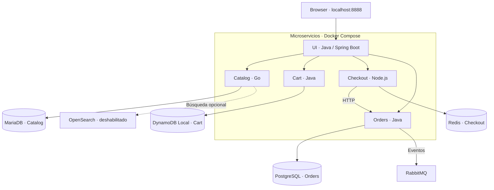
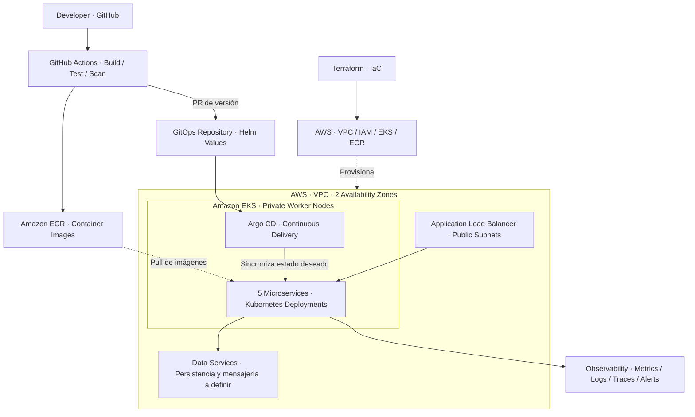

# 🚀 InfraLab v2 — Project Roadmap

### Internal Developer Platform · AWS · Kubernetes · GitOps

> **WORK IN PROGRESS** — De una aplicación de microservicios existente a una plataforma interna de despliegues automatizados.

**Aplicación de referencia:** [AWS Retail Store Sample App](https://github.com/aws-containers/retail-store-sample-app) — UI, Catalog, Cart, Orders y Checkout. El código de negocio pertenece al proyecto original; InfraLab v2 se enfoca en diseñar e implementar su plataforma DevOps.

## 🗺️ Roadmap

| Fase | Etapa | Tecnologías / enfoque | Estado |
|:---:|---|---|:---:|
| **01** | **Application Assessment** | Microservices · Architecture Review | ✅ Completada |
| **02** | **Application Validation** | Docker Compose · Health Checks · Integration Tests | 🔄 En curso |
| **03** | **Containerization** | Docker · Multi-stage Builds · Compose | ⏳ Pendiente |
| **04** | **Kubernetes Local** | Kind · Deployments · Services · Helm | ⏳ Pendiente |
| **05** | **AWS Infrastructure** | Terraform · VPC · IAM · ECR · EKS | ⏳ Pendiente |
| **06** | **CI/CD & GitOps** | GitHub Actions · Argo CD · GitOps | ⏳ Pendiente |
| **07** | **Observability & SRE** | Metrics · Logs · Traces · Scaling · Recovery | ⏳ Pendiente |
| **08** | **Developer Golden Path** | Reusable Templates · Self-Service Workflow | ⏳ Pendiente |

> `ROADMAP.md` es la fuente oficial del estado del proyecto. [ROADMAP_InfraLab_v2.md](ROADMAP_InfraLab_v2.md) conserva detalles suplementarios de implementación y criterios de aceptación.

---

## 🐳 Arquitectura actual — Local Environment

**Estado:** ejecutándose localmente con **Docker Compose** y las imágenes originales de AWS. Los cinco microservicios fueron observados en estado `healthy`. Aún falta verificar formalmente una compra de extremo a extremo y su persistencia.

> **Comunicación:** HTTP entre microservicios y RabbitMQ para eventos de Orders (no Kafka). OpenSearch está levantado en el entorno, pero la búsqueda está deshabilitada en la configuración actual.

---

## ☁️ Arquitectura objetivo — AWS Internal Developer Platform

**Estado:** **diseño propuesto; aún no desplegado**. La infraestructura será nuestra implementación con Terraform. La aplicación de referencia se utilizará para validar la plataforma.

**Principios de plataforma:** IaC reproducible, aislamiento de red, permisos mínimos (OIDC / Pod Identity), despliegues declarativos, observabilidad y reutilización del flujo de CI/CD. La elección final de bases de datos y servicios administrados se definirá durante el diseño de AWS.

---

### 🎯 Objetivo final

**From Microservices to Platform Engineering**

Construir un **Golden Path reutilizable** para incorporar nuevas aplicaciones y llevarlas desde GitHub hasta Kubernetes mediante CI/CD y GitOps, con una plataforma observable y automatizada.

**Estado real:** auditoría concluida · microservicios saludables en local · plataforma AWS/Kubernetes pendiente.
