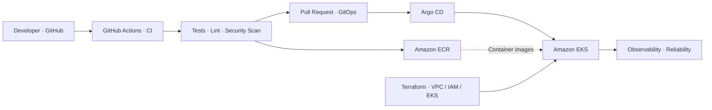

# 🚀 InfraLab v2 — Detailed Delivery Plan

### Internal Developer Platform · AWS · Kubernetes · GitOps

> **WORK IN PROGRESS** — De una aplicación de microservicios existente a una plataforma de despliegue automatizada, segura, observable y reutilizable.

> [!IMPORTANT]
> [`ROADMAP.md`](ROADMAP.md) es la fuente oficial para los nombres de las fases y su estado. Este documento conserva detalles suplementarios de implementación y criterios de aceptación; ante cualquier diferencia, prevalece `ROADMAP.md`.

**Objetivo:** diseñar e implementar una *Internal Developer Platform (IDP)* que permita construir, desplegar, actualizar y operar microservicios en Amazon EKS mediante Infrastructure as Code, CI/CD y GitOps.

**Aplicación de referencia:** [AWS Retail Store Sample App](https://github.com/aws-containers/retail-store-sample-app), compuesta por **UI, Catalog, Cart, Orders y Checkout**. El código de negocio procede del proyecto original; el foco de InfraLab v2 es construir y documentar nuestra propia plataforma DevOps.

**Estado actual:** `01 / 08 fases completadas` · `Application Assessment: completado` · `Application Validation: en curso`

---

## 🗺️ Roadmap general

| Fase | Área | Entregable principal | Estado |
|:---:|---|---|:---:|
| **01** | **Application Assessment** | Auditoría de servicios, dependencias y herramientas existentes | ✅ Completada |
| **02** | **Application Validation** | Builds, tests y ejecución integrada de los cinco servicios | 🔄 En curso |
| **03** | **Containerization** | Dockerfiles propios, Docker Compose e imágenes verificadas | ⏳ Pendiente |
| **04** | **Kubernetes Local** | Deployments y Helm charts propios sobre Kind | ⏳ Pendiente |
| **05** | **AWS Infrastructure** | VPC, IAM, ECR y EKS aprovisionados con Terraform | ⏳ Pendiente |
| **06** | **CI/CD & GitOps** | GitHub Actions + ECR + Argo CD + despliegue declarativo | ⏳ Pendiente |
| **07** | **Observability & SRE** | Métricas, logs, trazas y pruebas de resiliencia | ⏳ Pendiente |
| **08** | **Developer Golden Path** | Golden Path validado, demo, documentación y teardown | ⏳ Pendiente |

### Flujo objetivo de la plataforma

> **Arquitectura objetivo, aún no implementada.** GitHub Actions construirá y publicará imágenes; el repositorio GitOps declarará las versiones deseadas; Argo CD sincronizará aplicaciones con EKS. Terraform gestionará la infraestructura AWS.

---

## 📍 Fases y criterios de aceptación

### ✅ 01 — Application Assessment

**Objetivo:** comprender la aplicación antes de cambiar su forma de ejecución.

- [x] Identificar los cinco microservicios y sus responsabilidades.
- [x] Mapear tecnologías, dependencias, contratos OpenAPI y persistencia.
- [x] Inventariar Dockerfiles, Compose, Helm y automatizaciones originales.
- [x] Documentar qué archivos conservar, revisar o reemplazar.
- [x] Generar el informe [`REPOSITORY_ASSESSMENT.md`](./REPOSITORY_ASSESSMENT.md).

**Resultado:** auditoría estática completada. **No implica** que los builds, tests ni despliegues hayan sido validados.

### 🔄 02 — Application Validation

**Objetivo:** establecer una línea base funcional antes de modificar los artefactos originales.

- [ ] Preparar toolchains compatibles: Java 21, Go, Node.js y Yarn.
- [ ] Ejecutar builds, linters y tests reales por servicio.
- [ ] Identificar y ejecutar las integraciones que utilizan Testcontainers.
- [x] Levantar los cinco componentes en local con su configuración actual.
- [ ] Validar navegación, catálogo, carrito, checkout y creación de órdenes.
- [ ] Registrar resultados y bloqueos en el informe de auditoría.

**Criterio de salida:** línea base documentada, con resultados reproducibles y fallos conocidos claramente identificados.

### ⏳ 03 — Containerization

**Objetivo:** construir y comprender nuestra propia solución de contenedores.

- [ ] Diseñar Dockerfiles *multi-stage* para Java, Go y Node.js.
- [ ] Optimizar tamaño de imágenes, caché de capas y usuarios no privilegiados.
- [ ] Crear `.dockerignore` y configuraciones externas por servicio.
- [ ] Definir un `docker-compose.yml` propio para integración local.
- [ ] Verificar redes, puertos, variables de entorno y dependencias.
- [ ] Probar health checks y el flujo completo de compra.

**Criterio de salida:** aplicación ejecutable localmente mediante nuestras imágenes y Compose, con resultados comparables a la línea base.

### ⏳ 04 — Kubernetes Local

**Objetivo:** operar los microservicios en un clúster Kubernetes local antes de utilizar AWS.

- [ ] Crear un clúster Kind reproducible.
- [ ] Definir Deployments, Services, ConfigMaps y Secrets.
- [ ] Configurar readiness/liveness probes y requests/limits.
- [ ] Crear Helm charts parametrizables y reutilizables.
- [ ] Validar DNS interno, comunicación entre servicios y acceso a la UI.
- [ ] Probar reinicio de Pods y rolling updates locales.

**Criterio de salida:** cinco servicios operativos en Kind, instalados y actualizados mediante Helm.

### ⏳ 05 — AWS Infrastructure

**Objetivo:** aprovisionar la plataforma cloud con Terraform, sin pasos manuales imprescindibles.

- [ ] Diseñar módulos Terraform y separación de estados/entornos.
- [ ] Crear VPC con subnets públicas y privadas en dos Availability Zones.
- [ ] Configurar routing, Security Groups, IAM y conectividad de salida.
- [ ] Aprovisionar Amazon ECR y Amazon EKS con Managed Node Groups.
- [ ] Habilitar acceso controlado con IAM, OIDC y EKS Pod Identity según corresponda.
- [ ] Configurar ingreso con AWS Load Balancer Controller y ALB.
- [ ] Documentar costos, dependencias y procedimiento de limpieza.

**Criterio de salida:** `terraform apply` crea la infraestructura, los nodos están listos y los servicios se pueden ejecutar en EKS.

### ⏳ 06 — CI/CD & GitOps

**Objetivo:** automatizar el proceso desde el cambio de código hasta el despliegue.

- [ ] Crear workflows reutilizables de GitHub Actions.
- [ ] Ejecutar compilación, tests, lint y escaneo de dependencias/imágenes.
- [ ] Publicar imágenes versionadas en ECR utilizando credenciales temporales vía OIDC.
- [ ] Definir repositorio GitOps con versiones y configuración declarativa.
- [ ] Configurar Argo CD para sincronizar los Helm releases en EKS.
- [ ] Probar actualización por Pull Request, despliegue y rollback.

**Criterio de salida:** un cambio aprobado sigue la ruta **GitHub → CI → ECR → GitOps → Argo CD → EKS**, sin despliegues manuales desde CI.

### ⏳ 07 — Observability & SRE

**Objetivo:** entender qué pasa con las aplicaciones y cómo responden ante fallas.

- [ ] Centralizar logs y recopilar métricas de infraestructura/aplicación.
- [ ] Evaluar OpenTelemetry y trazas distribuidas entre servicios.
- [ ] Configurar dashboards, alertas y notificaciones relevantes.
- [ ] Ejecutar pruebas de carga y analizar latencia, errores y recursos.
- [ ] Simular caída de Pods y verificar recuperación automática.
- [ ] Evaluar HPA, rolling updates, rollback y comportamiento degradado.

**Criterio de salida:** incidentes detectables y pruebas documentadas con evidencia de métricas, logs y recuperación.

### ⏳ 08 — Developer Golden Path

**Objetivo:** demostrar que la solución es una plataforma repetible, no un despliegue aislado.

- [ ] Documentar un **Golden Path** para incorporar y desplegar un servicio.
- [ ] Probar la reutilización de plantillas, workflows y Helm charts.
- [ ] Ejecutar un flujo completo de CI/CD y GitOps con la aplicación funcionando.
- [ ] Registrar decisiones de arquitectura (ADRs), riesgos y resultados.
- [ ] Preparar un video técnico con demostración verificable.
- [ ] Limpiar recursos creados dinámicamente por Kubernetes.
- [ ] Ejecutar `terraform destroy` y verificar recursos AWS residuales/facturables.

**Criterio de salida:** despliegue reproducible, documentación suficiente y ciclo de vida completo comprobado.

---

## 🧰 Stack objetivo

| Capa | Tecnología |
|---|---|
| Aplicación | Java / Spring Boot · Go · Node.js / NestJS |
| Contenedores | Docker · Docker Compose · Amazon ECR |
| Orquestación | Kubernetes · Kind · Amazon EKS |
| Infraestructura | Terraform · Amazon VPC · IAM · ALB |
| Despliegues | Helm · GitHub Actions · Argo CD · GitOps |
| Seguridad | IAM least privilege · OIDC · Pod Identity · RBAC · Image scanning |
| Observabilidad | CloudWatch · OpenTelemetry (a evaluar) · métricas, logs y alertas |
| Testing | Tests de servicio · Testcontainers · Cypress · Artillery |

## 🎯 Definición de éxito

InfraLab v2 estará listo para presentarse como una **Internal Developer Platform** cuando podamos demostrar que:

1. La plataforma se aprovisiona con código, sin depender de configuración manual no documentada.
2. Los microservicios se compilan, prueban y publican mediante pipelines repetibles.
3. Argo CD despliega versiones aprobadas desde GitOps en EKS.
4. Las aplicaciones son accesibles, observables y recuperables ante fallas controladas.
5. El procedimiento de teardown elimina la infraestructura temporal y verifica recursos residuales.
6. El proceso es reutilizable para incorporar al menos otra aplicación o servicio sin rediseñar la plataforma.

---

## 🔭 Evolución futura — Fuera del alcance del MVP

- **ECS Fargate Comparison:** desplegar la misma aplicación sobre ECS y contrastar su operación con EKS.
- **AWS → GCP Migration Lab:** migrar EKS → GKE mediante transferencia gradual de tráfico, observabilidad, estrategia de datos y rollback. *La continuidad del servicio será un objetivo a comprobar con pruebas, no una garantía previa.*

---

### Créditos y alcance

- **Código de aplicación:** [AWS Retail Store Sample App](https://github.com/aws-containers/retail-store-sample-app). Se conservan licencias y atribuciones originales.
- **Trabajo de InfraLab v2:** análisis, contenerización propia, infraestructura AWS, plataforma Kubernetes, automatización, GitOps, seguridad, observabilidad y validación, **a medida que cada etapa se implemente**.
- **Seguimiento:** actualizar el estado oficial en [`ROADMAP.md`](ROADMAP.md). Mantener aquí únicamente el detalle y los criterios de aceptación.

> **InfraLab v2 — FROM MICROSERVICES TO PLATFORM ENGINEERING**  
> **BUILD · CONTAINERIZE · ORCHESTRATE · AUTOMATE · OBSERVE**
